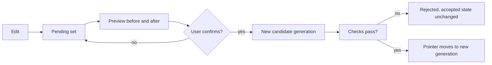

# Design note: lineup editing (issue #56, editing part)

Design note only. No code and no tests. Written Nov 23, 2026 from the planning notes. Nothing was run. See "Not verified".

Owner decision (Nov 23, 2026): #56 covers editing the lineup as well as viewing it. View and explain is in LINEUP-WORKSPACE-CONTRACT-NOTE.md. This note covers what comes after it.

## The problem

A user who has accepted a lineup wants to fix it without files or PowerShell: pin a channel, change an order, rename, merge two entries, hide one. Today none of that is possible in the browser.

## What a user can edit

| Edit    | Meaning                                                  | Guardrail                                                                        |
| ------- | -------------------------------------------------------- | -------------------------------------------------------------------------------- |
| Pin     | Keep a channel (or its logo) fixed across rebuilds.      | Never changes a guide id.                                                        |
| Reorder | Change channel order or number.                          | Number is presentation only. It never feeds a guide id.                          |
| Rename  | Change the display name.                                 | Display only. Guide id stays.                                                    |
| Merge   | Show two entries as one channel with a preferred source. | Both stay in the data. Nothing is dropped.                                       |
| Hide    | Leave a channel out of the published playlist and guide. | Hidden is a flag, not a delete. The channel stays in accepted state and in view. |

Not editable: guide bindings (guide-id contract v1.0 is frozen), anything that drops a channel, the `guide: null` marker.

## Pending change sets

- An edit never writes accepted state. It goes into a pending change set.
- A set holds many edits. Each item shows exact before and after.
- The user reviews the whole set, then applies it. Apply is all or nothing.
- Pending is not publication. Applying a set makes a new candidate; it does not publish.
- The set lives in durable state (ADR-0009 "review and approval records"), not in the browser.
- The browser calls only documented engine commands over the loopback server (ADR-0016). It never writes files.

## Undo

- Before apply: remove an item or discard the set. Nothing changed yet.
- After apply: the generation store is immutable and a pointer selects the current one. Undo is "build a new generation that restores the old values" or "point back at the older generation". It is never an edit of an old generation.
- Owner decision needed: which undo model. Option A: point back at the older generation (simple, cheap). Option B: build a new restoring generation (keeps a full history). Recommendation: A for the first release; B only if the audit trail needs it.

## How a change reaches accepted state

## Rollback

If a check fails, or the pointer move fails, accepted state stays exactly as it was and the user sees a plain message. A half-applied set is never left behind. After a good apply, the previous generation is kept so "Undo last apply" works.

## How edits survive a rebuild

A rebuild reads sources again and may change entries. Edits are stored as rules keyed by the stable channel id, not by position or number. On rebuild each rule is re-applied. If its channel is gone, the rule is kept as "orphaned", shown to the user, and never silently deleted. If a rule now conflicts with a new source entry, the rebuild stops for review instead of choosing.

Owner decision needed: what to do with an orphaned rule after N rebuilds. Option A: keep forever until the user removes it. Option B: expire after a set time. Recommendation: A.

## Why an ADR is needed

Pending change sets and rollback touch accepted state, durable state (ADR-0009) and the audit trail. They set a rule that many later features rely on (multi-user, set-top box). That decision must be written down once and reviewed, not found inside code. See the draft below.

## Draft ADR outline: pending changes and rollback

- Title: ADR-NNNN Pending changes and rollback for lineup edits
- Status: Proposed
- Context: Issue #56 editing; accepted state is immutable by generation; no way to stage or undo.
- Decision (to be reviewed): edits are rules keyed by stable channel id; staged in pending sets; applied all or nothing into a new candidate; the pointer moves only after checks pass; previous generation kept for undo.
- Consequences: one apply path for CLI and browser; orphaned rules are visible; storage grows by one record per set.
- Frozen: guide-id contract v1.0, `guide: null`, never drop a channel.
- Verification: apply failure leaves accepted state byte-identical; undo restores prior bytes; a rebuild keeps rules.
- Related: #56, #25, #26, ADR-0009, ADR-0016.

## Size and order

Build after the view-only workspace (56-B, 56-C). First edit slice should be pin only, because a pin command already exists.

## Not verified

- No code read. Whether the engine already has a candidate/pointer API that a pending set can use.
- Exact stable channel id source.
- Whether issues #25 and #26 are done.
