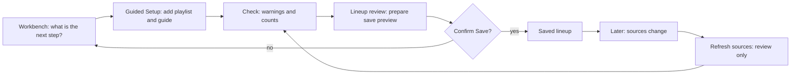

# Milestone 3 workflow map: the beginner path through the local review UI

This is a planning document. It adds no code and no tests. It comes from reading this tree on Nov 23, 2026 (ADR-0006, ADR-0016, `gui/src/app/navigation.ts`, `gui/src/app/webStatus.ts`, `gui/src/app/guidedSetupProposal.ts`, the pages under `gui/src/pages`, `docs/user/CURRENT_LIMITATIONS.md`, `docs/planning/GUIDED-SETUP-BROWSER-DESIGN-NOTE.md`). Nothing was run. Items I could not confirm are under "Not verified".

ADR-0006 asks for personas, journeys, task flows, a safety model, a feedback model and an error prevention model before GUI work. This page is that set for the current app and for the Milestone 3 pages that extend it.

## Ground rules (owner decisions in force)

- ChannelForge is a client/server system. It builds guides and playlists for Plex and other IPTV viewers, and that must keep working on its own. The set-top-box part (browse and start playback) is optional and builds on top. Today only the review UI for the person who builds the lineup exists.
- Today the UI runs on this computer only (loopback, ADR-0016). Server mode needs a login design and an ADR amendment first. It serves files from `gui\dist` only.
- Secrets and logins never appear in the UI. A credentialed source shows its host only.
- Frozen contracts do not change (guide-id contract v1.0, the `guide: null` marker, no dropped channels). The UI never changes M3U, XMLTV or accepted-state bytes.
- Nothing is accepted automatically. Only the user's explicit Save changes accepted state.

## Personas

| Persona         | Who                                                                                | What they want                                                         | What they do not know                          |
| --------------- | ---------------------------------------------------------------------------------- | ---------------------------------------------------------------------- | ---------------------------------------------- |
| New builder     | Owns a playlist and a guide from a provider or an old tool. Not a PowerShell user. | A clean lineup in Plex or another player, without breaking what works. | Terms such as XMLTV, M3U, binding, generation. |
| Returning owner | Already saved a lineup. Comes back when a source changes.                          | See what changed, keep what works, fix what broke.                     | Why a refresh did not change anything.         |
| Helper          | A family member or friend who set things up for someone else.                      | Check state quickly and leave.                                         | The history of the setup.                      |

The command-line operator is not a persona of this UI. The CLI stays the full-power path.

## The path in one picture

## Journeys

1. **First lineup (New builder).** Open Workbench, follow its one next step to Guided Setup, add a playlist and a guide, read the check, review the lineup, save it, see it under Saved lineup.
2. **Keep it current (Returning owner).** Open Workbench, read source status, refresh sources, read what changed, decide to review again or leave the saved lineup alone.
3. **Something looks wrong (Returning owner, Helper).** Read the status banner, see which source needs attention, remove or replace that source, check again. Accepted state stays as it was until a new Save.
4. **Look around (Helper).** Open Live Now or Wrestling to see what is on. No setup change is possible there.

## Pages, routes and what can go wrong

"Available" is from `navigation.ts` today. Placeholders are marked.

| Step | Page (nav label)                   | Available        | What it does                                                                                                                                                                         | Engine routes it uses                                                             | What can go wrong                                                                                                                                                                                                                                                                                             |
| ---- | ---------------------------------- | ---------------- | ------------------------------------------------------------------------------------------------------------------------------------------------------------------------------------ | --------------------------------------------------------------------------------- | ------------------------------------------------------------------------------------------------------------------------------------------------------------------------------------------------------------------------------------------------------------------------------------------------------------- |
| 0    | Workbench                          | yes              | Shows the safest next step, source status, a safety card ("Before you save").                                                                                                        | `GET /api/status`                                                                 | Status unavailable: the page must say so and not show a stale "ready". Refresh is hidden when `canRefreshSources` is false.                                                                                                                                                                                   |
| 1    | Guided Setup                       | yes              | Choose a workspace, add playlists and guides (local file or public HTTPS URL), tie each guide to playlists, run the check.                                                           | `POST /api/guided-setup/proposal`                                                 | Error codes map to plain messages (`invalid-playlist`, `invalid-guide`, `source-unavailable`, `unsupported-source`, `file-too-large`, `request-too-large`, `package-data-unavailable`, `proposal-unavailable`, and request-shape codes). A guide over 12 MB is refused in the browser (use the command line). |
| 1a   | Playlist, Guide                    | placeholder      | Planned as separate add pages. Today both live inside Guided Setup.                                                                                                                  | none yet                                                                          | Do not enable a nav item that has no page.                                                                                                                                                                                                                                                                    |
| 2    | Check result (inside Guided Setup) | yes              | Counts and warnings: `ambiguous-guide-match`, `unmatched-playlist-entry`, `guide-only-record`, `guide-unbound-actionable`, `logo-check`. The user must acknowledge before moving on. | same proposal response                                                            | An ambiguity blocker stops the path. `logo-check` text mentions a PowerShell command; a beginner needs plain words (gap).                                                                                                                                                                                     |
| 3    | Lineup                             | partly, by state | Shows what the check found (aggregate counts). Prepare a save preview.                                                                                                               | `POST /api/guided-setup/accept` (preview and save)                                | The preview shows counts only, not channels (gap: read-only lineup page, issue 56). Revalidation at save can refuse a stale candidate.                                                                                                                                                                        |
| 4    | Save dialog                        | yes              | "Save this lineup?" with Cancel. Save is the only step that changes accepted state.                                                                                                  | `POST /api/guided-setup/accept`                                                   | Cancel leaves accepted state unchanged. A failed save must say that nothing was saved.                                                                                                                                                                                                                        |
| 5    | Saved lineup                       | by state         | Confirms accepted local state exists, with summary counts. Does not export, schedule, publish or edit.                                                                               | none beyond status                                                                | The page must not imply publishing happened.                                                                                                                                                                                                                                                                  |
| 6    | Refresh (on Workbench)             | yes              | Refreshes all saved sources, review only. A changed source makes new review evidence.                                                                                                | `POST /api/sources/refresh` (no body)                                             | A failed source keeps its last-known-good copy and shows `source-unavailable`. No per-source refresh route exists in the browser today.                                                                                                                                                                       |
| 7    | Remove source (on Workbench)       | yes              | Removes one saved source.                                                                                                                                                            | `POST /api/sources/remove`                                                        | Failure message: "Your saved sources were not changed."                                                                                                                                                                                                                                                       |
| 8    | Live Now, Wrestling                | yes              | Read-only browse of what is on now or soon.                                                                                                                                          | `GET /api/one-guide/live-now`, `/starting-soon`, `/category/<key>`, `/items/<id>` | Empty data must say why, not show a blank page.                                                                                                                                                                                                                                                               |
| 9    | Automatic updates                  | placeholder      | Planned review of the opt-in scheduled refresh.                                                                                                                                      | none yet                                                                          | Same rule: refresh never accepts.                                                                                                                                                                                                                                                                             |
| 10   | Learn                              | placeholder      | Planned glossary of terms.                                                                                                                                                           | none (static)                                                                     | Terms on pages must match the glossary.                                                                                                                                                                                                                                                                       |

## Task flows

**Add sources and check.**

1. Pick or confirm the workspace.
2. Add one or more playlists (file or HTTPS URL). Give each a friendly name.
3. Add zero or more guides. With one playlist the guide binds to it. With several, the user picks playlists or "All playlists".
4. Press check. The server stages the sources and builds a candidate. Nothing is saved.
5. Read counts and warnings. Acknowledge them.

**Review and save.**

1. Open the lineup review. Read what the check found.
2. Prepare the save preview (aggregate counts, accepted state unchanged).
3. Press Save lineup, read the dialog, confirm or cancel.
4. On success, the Saved lineup item shows the result. On failure, the page says accepted state is unchanged.

**Refresh and recover.**

1. On Workbench read the source rows (`ready`, `changes-found`, `source-unavailable`, `not-refreshed`).
2. Press refresh. Nothing is accepted by it.
3. If a source is unavailable, the last-known-good copy is kept. The user fixes the URL or file, or removes the source, then checks again.
4. If a new check looks worse than the saved lineup, the user does not save. The saved lineup keeps serving.
5. After a wrong Save: today accepted state is immutable and last-known-good is kept. The browser has no "go back to the previous saved lineup" button. See the open questions.

## Safety model

| Action                                                                    | Class                      | Rule                                                                                    |
| ------------------------------------------------------------------------- | -------------------------- | --------------------------------------------------------------------------------------- |
| Browse Live Now, Wrestling, status                                        | Read-only                  | No confirmation.                                                                        |
| Add or edit sources in setup, run the check                               | Reversible (nothing saved) | No confirmation. Staged only.                                                           |
| Refresh sources                                                           | Reversible                 | Review only. Prior snapshot kept on failure.                                            |
| Remove a saved source                                                     | Needs care                 | Name the source in the action. State what changes. Failure leaves sources unchanged.    |
| Save lineup                                                               | Confirm                    | Explicit dialog with Cancel. Preview first. The native acceptance boundary revalidates. |
| Edit tracked files, show secrets, send a local file path from the browser | Prevented                  | No UI path exists (ADR-0006 rule 10, ADR-0016).                                         |
| Accept automatically after a refresh                                      | Prevented                  | No route does this.                                                                     |

## Feedback model

- State is always visible: Workbench shows source status and the last checked time. Saved-lineup state shows in navigation.
- Every action ends with a plain sentence saying what happened and what did not change ("Accepted state is unchanged", "Your saved sources were not changed").
- Status messages use `role="status"` and live regions. Errors move focus to the message.
- Counts are shown as numbers with a one-line meaning. Raw codes are not shown to the user.
- Terms are explained where used (TermCoach today, Learn page later).

## Error prevention model

- Structural: the browser sends file contents or a public HTTPS URL, never a local path. URLs with credentials, query strings or fragments are refused.
- Structural: Save is reachable only after check and preview. The acknowledgement gate and the ambiguity blocker stop a bad candidate before the Save button.
- Structural: placeholder nav items are disabled, so there are no dead pages.
- Defaults: a single playlist means automatic guide binding. Unbinding is explicit.
- Size limits: the 12 MB guide cap is caught before upload and the message points to the command line.
- Not prevented today: choosing a wrong but valid guide. The check reports `guide-only-record` and `unmatched-playlist-entry` so the user can notice.

## How this extends to the other M3 pages

Each new page must state, in its own slice, five things: the goal sentence, the route used, what can go wrong, what it never changes, and how it ends (the feedback sentence). New pages: Lineup (read-only list with search and filters), Glossary (`Learn`), Playlist and Guide split pages, Automatic updates. Reuse `StatusBanner`, `StatusBadge`, `StepRail`, `TermCoach`, the tokens in `tokens.css`, and the fetch helpers in `webStatus.ts`.

## Not verified

- I did not read every page in full or run the app. Route names come from the milestone map, `webStatus.ts` and `guidedSetupProposal.ts`.
- I did not search for an existing engine rollback command. The recovery text rests on "accepted state is immutable, last-known-good is kept" from the docs only.
- Exact button wording on each page was not checked against the source.

## Open questions for the owner

1. Close issue #10 once this map is merged and move the remaining UI work into the other M3 issues? Recommendation: yes.
2. Should the UI offer "go back to the previous saved lineup"? Recommendation: first confirm an engine command exists (slice 10-B). Do not build a button before that.
3. Should the persona list include the command-line operator? Recommendation: no. The CLI stays the full-power path.
