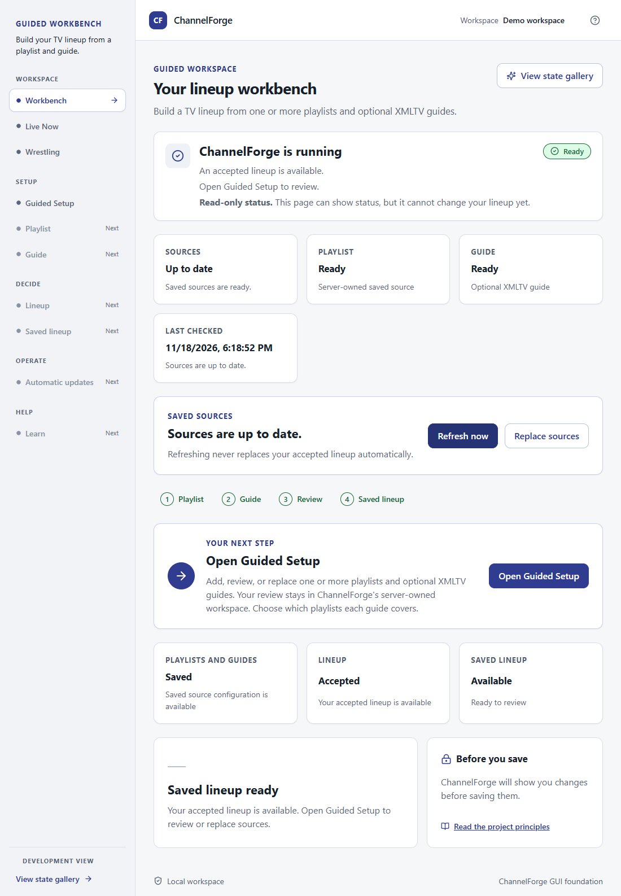
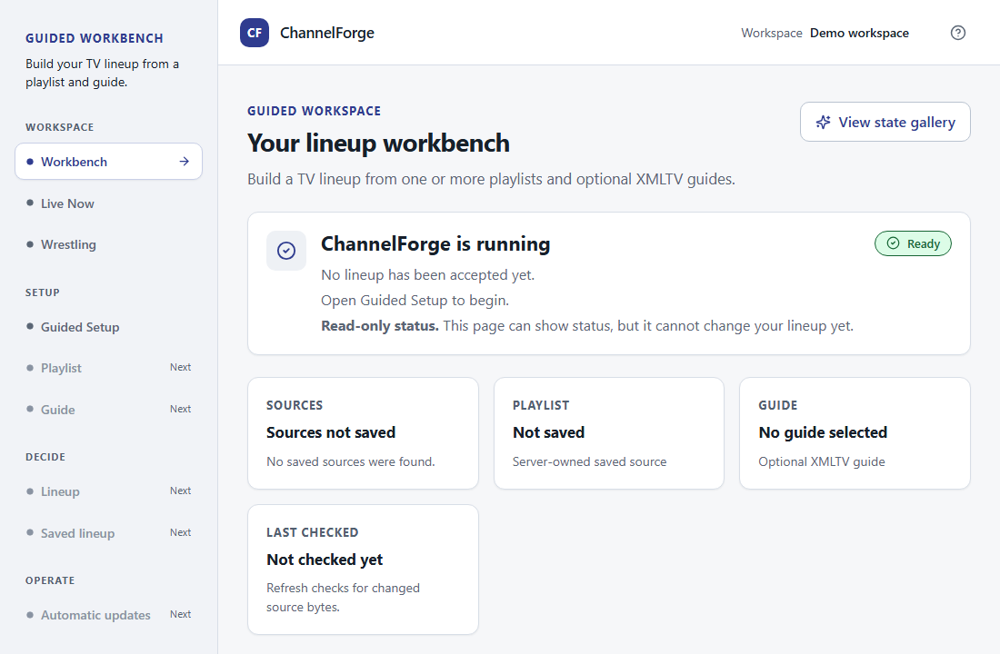

# Install ChannelForge on Windows

ChannelForge alpha 1 is a portable Windows x64 bundle. It does not install a Windows service and does not require administrator rights.

## What this is not

- **Not a Windows service.** ChannelForge runs while you run **Start ChannelForge.cmd**. It does not start at boot. To refresh sources on a schedule, use the opt-in daily scheduled refresh (see [Current Limitations](CURRENT_LIMITATIONS.md)).
- **Not reachable from other devices.** The server listens on `127.0.0.1` only, and there is no sign-in. Open it from the same computer.
- **Not Docker.** There is no Docker image yet. A Docker image and a Windows server install are planned.
- **Not the old desktop app.** The screens are in your browser. See [Where the Tauri work went](WHERE-THE-TAURI-WORK-WENT.md).

## Install

1. Download `ChannelForge-v0.1.0-alpha.1-windows-x64.zip` from the approved project artifact location.
2. Extract the ZIP to a temporary folder.
3. Double-click **Install ChannelForge.cmd**.
4. The installer copies the verified application to `%LOCALAPPDATA%\ChannelForge` and starts the local server.
5. Confirm that the browser opens `http://127.0.0.1:8765/`. If port 8765 is already in use, the server does not start. Close the other program, then run **Start ChannelForge.cmd** from `%LOCALAPPDATA%\ChannelForge`.

If ChannelForge is already installed, **Install ChannelForge.cmd** runs an update instead (see [UPDATE-WINDOWS.md](UPDATE-WINDOWS.md)).

The bundle includes the official PowerShell `7.6.6` win-x64 portable ZIP
runtime, pinned by its release-archive SHA256 in `package-manifest.json`. The
launcher uses loopback only and stores runtime logs under
`%LOCALAPPDATA%\ChannelForge\state\runtime`.

## First run

Use the guided setup screen to add your playlist, add an optional guide, check which guide goes with which playlist, and select **Analyze source set**. Read the results, tick the box that says you reviewed them, and select **Accept reviewed proposal**. Then open **Workbench** and use **Refresh now** to refresh your sources.

The pictures use sample files that ship with the project, not real provider data.

Do not place secrets in the extracted ZIP or commit provider files. Follow [SECURITY.md](../reference/SECURITY.md) for local provider-file rules.

