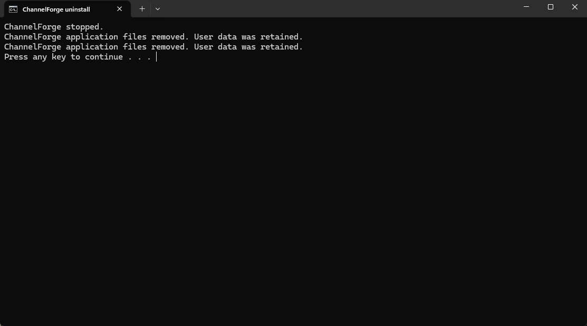

# Uninstall ChannelForge on Windows

The portable bundle has no Windows service and no registry installer entry. Uninstall is performed from the bundle command file.

## Uninstall

1. Close the ChannelForge browser tab.
2. Double-click **Uninstall ChannelForge.cmd**.
3. Choose one of two options by typing 1 or 2 and pressing Enter. Anything else cancels and removes nothing.

### Option 1: Keep my lineup and saved sources

Removes only the application files from `%LOCALAPPDATA%\ChannelForge`. Your saved sources, settings, lineup output, caches, logs, and update backups stay for a later reinstall.

### Option 2: Delete all ChannelForge data

Removes the application and also your lineup, saved sources, and settings. This cannot be undone. Before anything is removed, the window asks you to type the word DELETE in capital letters. If you type anything else, the uninstall is cancelled and nothing is removed.

Only ChannelForge's own folders are deleted. Other files that happen to sit next to them are left alone.

